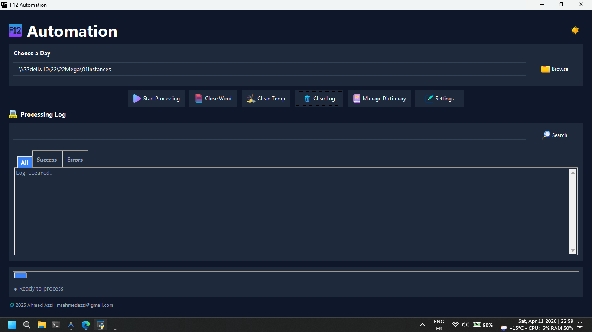

<div align="center">
  

  # F12 Automation

  <p>
    <strong>A production-grade MS Word document processor & automation tool built with a robust Clean Architecture.</strong>
  </p>

  <p>
    <a href="#features">Features</a> •
    <a href="#architecture">Architecture</a> •
    <a href="#installation">Installation</a> •
    <a href="#usage">Usage</a>
  </p>
</div>

## ✨ Features

- **Automated Document Processing**: Batch process `.doc` and `.docx` files by matching patient names and extracting normalized medical terminology seamlessly.
- **Smart Medical Dictionary**: A dynamic mapping interface supporting custom and unified medical term synonym management (using fuzzy context comparisons).
- **COM Lifecycle Management**: Safely and reliably orchestrates background MS Word processes (`win32com`) with failsafe `taskkill` fallbacks.
- **Micro-Animations & Theming**: Includes an aesthetic, fully decoupled dark/light mode engine providing responsive and fluid interfaces.
- **High-Performance Scalability**: Refactored into distinct feature slices with `tkinter` code strictly bounded to the presentation layer.

## 🏗️ Architecture

F12 Automation employs a strict **Feature-Slice / Clean Architecture**, aggressively decoupling business logic from UI bindings and file integrations.

```text
App/
├── main.py                        # Thin bootstrapper
├── shared/
│   ├── config/                    # Themes, Constants, Configuration settings
│   ├── domain/                    # Interfaces and shared Data structures
│   └── utils/                     # Pub-sub Loggers
├── features/
│   ├── dictionary/                # Medical definitions & user JSON repository
│   ├── document_matching/         # Intelligent medical exam extraction & MS Word parsing
│   └── word_automation/           # Infrastructure lifecycle memory-management
└── data/                          # Persistent storage state
```

## 🚀 Installation

1. Clone or download the repository to your local machine.
2. Ensure you have Python installed, then create and activate a virtual environment.
3. Install the dependencies using the `requirements.txt` file located in the `App` directory:

```bash
cd App
pip install -r requirements.txt
```

> **Note**: This tool utilizes the `win32com` package to control Microsoft Word locally. Make sure you are running a Windows operating system and have Microsoft Office installed.

## 🔌 Usage

1. Open your terminal in the target directory.
2. Navigate to the `App` folder.
3. Launch the application:

```bash
python main.py
```

- Navigate the **Dashboard** to select your target temporal mapping directory.
- Use the **Dictionary Manager** component to feed alias mappings.
- Track metrics using the built-in isolated **Log Console**.

---
<div align="center">
  <p>Engineered for high maintainability • 2025</p>
</div>
