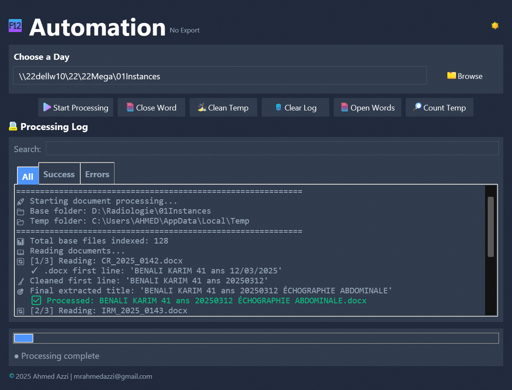
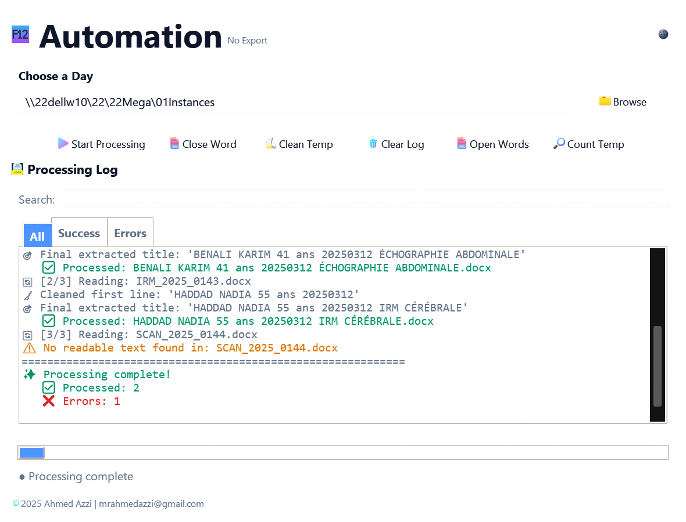
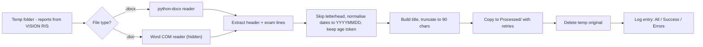

<div align="center">


# F12 Automation

**Batch-renames radiology reports with patient name, age, exam type and date — automatically, without touching a single file by hand.**

[](https://www.python.org/)
[](#-requirements)
[](#-features)
[](#-how-it-works)
[](LICENSE)



</div>

---

## ✨ What it does

A radiologist's day folder fills up with Word reports named `CR_2025_0142.docx`, `IRM_0143.doc`, … Opening one by one to find out *who* the patient is wastes hours.

**F12 Automation** reads every report, extracts the meaningful header — patient name, age, date and the exam performed — and renames the file to something readable:

```text
CR_2025_0142.docx  ➜  BENALI KARIM 41 ans 20250312 ÉCHOGRAPHIE ABDOMINALE.docx
IRM_0143.doc       ➜  HADDAD NADIA 55 ans 20250312 IRM CÉRÉBRALE.doc
```

Files are then moved into a `Processed` folder inside the same day directory, so the working folder stays clean and the archive stays searchable.

---

## 🚀 Features

| | Feature | Details |
|---|---|---|
| 🧠 | **Smart title extraction** | Reads the first non-letterhead paragraph, then every line until `INDICATION` / `RÉSULTATS` becomes the exam description. |
| 🏥 | **Letterhead filtering** | Clinic names, addresses, phone numbers and specialties (`CABINET`, `IMAGERIE MÉDICALE`, `ERAHMA`, `Mostaganem`, …) are skipped automatically. |
| 📅 | **Date normalisation** | `12/03/2025` and `12-03-2025` both become `20250312` — sortable, filename-safe. |
| 🎂 | **Age detection** | Keeps `41 ans` / `7 mois` tokens; if the patient line lacks one, it scans the surrounding lines. |
| 📄 | **`.doc` + `.docx`** | Modern files via `python-docx`; legacy `.doc` via a hidden Word COM instance created only when needed. |
| 🔁 | **Network-safe moves** | Copy → verify → delete with 5 retries and back-off, built for SMB shares that keep files locked. |
| ✂️ | **Filename hygiene** | Titles truncated to 90 characters, duplicates suffixed `_1`, `_2`, … |
| 🎨 | **Dark / light UI** | Animated theme engine with custom cards, tabs and typography — no external theme packages. |
| 🔍 | **Triage logs** | Three tabs (*All*, *Success*, *Errors*) plus instant client-side search over the whole run. |
| 🧵 | **Non-blocking** | Processing, Word cleanup and VISION RIS automation all run on background threads; the UI never freezes. |
| 🖱️ | **VISION RIS helper** | With `pywinauto` UIA it walks the RIS table, reads each real patient name and opens the matching `R Ligne i` cell — skipping empty rows. |
| 🧹 | **Housekeeping** | *Close Word*, *Clean Temp* and *Count Temp* keep orphan `WINWORD.EXE` processes and gigabytes of temp files under control. |

---

## 🖼️ Screenshots

<div align="center">

**Light theme — full run finished, 2 processed / 1 error**



</div>

---

## 🔬 How it works



Every run reports `{ processed, errors }`, then releases Word and its COM references explicitly (`Quit` → `gc.collect` → sleep) so the next run is never blocked by a ghost file lock.

---

## 📦 Requirements

- **Windows 10/11**
- **Python 3.10+** (only for running from source)
- **Microsoft Word** — required for `.doc` files and for the VISION RIS helper; `.docx` works without it
- Read/write access to the day folder (local disk or SMB share)

```text
python-docx    # .docx reading
pywin32        # Word COM automation
pywinauto      # VISION RIS UI automation
Pillow         # icons + theme assets
PyInstaller    # packaging (build only)
```

---

## ⚡ Installation

### Option A — installer (no Python needed)

```powershell
installer\F12AutomationNoExport_Setup.exe
```

Creates Start-menu and desktop shortcuts for **F12 Automation (No Export)**.

### Option B — portable executable

```powershell
installer\main.exe
```

### Option C — from source

```powershell
git clone https://github.com/AhmedAzzi/F12-Automation.git
cd F12-Automation\App
python -m pip install -r requirements.txt
python main.py
```

---

## 🕹️ Usage

1. **Choose a Day** — pick the folder that holds today's reports (or type a UNC path such as `\\server\share\01Instances\2026-11-17`).
2. Make sure the reports to rename are in your **temp folder** (the one VISION RIS prints to) — that is the queue the app consumes.
3. Press **Start Processing**.
4. Watch the log: each file gets its extracted title, its cleaned patient line and its final destination. Failures are grouped under **Errors** so you can fix them and re-run.
5. Results land in `<day folder>\Processed\`, named after the patient and the exam.

| Button | Action |
|---|---|
| **Start Processing** | Scans temp, renames and files every `.doc` / `.docx` |
| **Close Word** | Terminates every running Word instance (recovers stuck locks) |
| **Clean Temp** | Deletes all files in the temp folder after confirmation |
| **Count Temp** | Reports how many files are waiting in temp |
| **Clear Log** | Empties all three log tabs |
| **Open Words** | Drives VISION RIS: opens each `R Ligne i` row and closes the popup |
| 🌙 / ☀️ | Toggles dark / light theme |

---

## 🗂️ Project structure

```text
F12-Automation/
├── App/
│   ├── main.py                     # Entry point — wires the GUI to Tk
│   ├── core/
│   │   ├── document_processor.py    # Header parsing, naming rules, file moving
│   │   ├── word_utilities.py        # Word lifecycle, temp cleanup, VISION RIS driver
│   │   └── robocopygui.py           # Standalone "Advanced File Mover" utility window
│   ├── gui/
│   │   └── document_processor_gui.py # Theme engine, cards, log tabs, threading
│   ├── icons/                       # UI assets (PNG/ICO)
│   ├── main.spec                    # PyInstaller build recipe
│   └── setup_config.iss             # Inno Setup installer script
├── installer/
│   ├── main.exe                     # Portable build
│   └── F12AutomationNoExport_Setup.exe
├── docs/images/                     # README screenshots
└── LICENSE
```

Standalone file-copy window:

```powershell
python -m core.robocopygui
```

---

## 🔨 Build from source

```powershell
cd App
pyinstaller --clean main.spec          # produces dist\main.exe
iscc setup_config.iss                  # produces ..\installer\F12AutomationNoExport_Setup.exe
```

`main.spec` bundles the `icons/` folder and embeds `icons8-f12-key-100.ico`; `setup_config.iss` writes its output straight into `..\installer\`.

---

## 🩺 Troubleshooting

| Symptom | Fix |
|---|---|
| `Base folder does not exist` | The day folder path is wrong or the share is offline — pick it again with **Browse**. |
| `.doc` files are skipped | Word is not installed, or COM is not registered: run `python -m pywin32_postinstall -install` in an elevated shell. |
| Files stay in temp after a run | Another process holds them — press **Close Word**, then re-run; the app retries 5 times with back-off. |
| “No readable text found” | The report's first paragraphs are only letterhead, or the file is empty/scan-only. |
| `Neither 'VISION RIS' nor 'GENERAL_LIGHT' found` | The RIS window must be open at the *same* privilege level as the app (both normal or both elevated). |
| Icons missing in the window | Run from `App\` (relative `icons/` lookup) or use the packaged `.exe`. |

---

## 🧭 Notes

- This repository ships the **No Export** variant: it organises and renames reports, nothing is exported to a database or a spreadsheet.
- Patient data never leaves the machine — the app only reads local/network Word files and writes them back to the same share.
- The unreleased *Clean Architecture* refactor lives on the archived branch `archive/refactor-2026`.

---

<div align="center">

**Built for the radiology desk of Dr. Ahmed Azzi** · [mrahmedazzi@gmail.com](mailto:mrahmedazzi@gmail.com)

Released under the [MIT License](LICENSE) · © 2025 Ahmed Azzi

</div>
